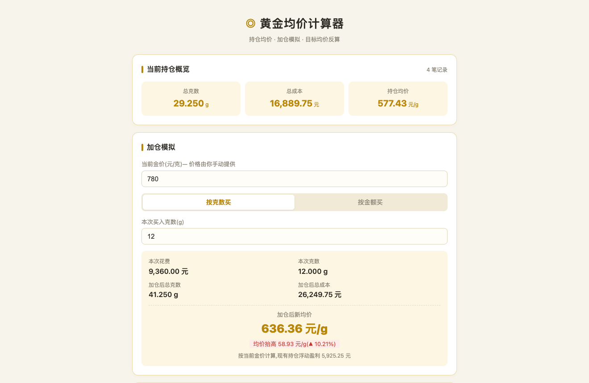
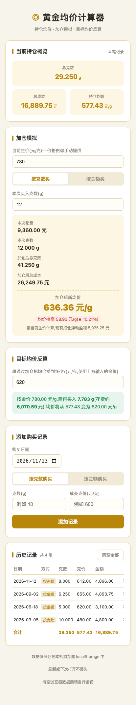

<div align="center">

# ◎ 黄金均价计算器

**攒金人自己的加仓测算器 —— 买多少克,均价摊到多少,一目了然**

[](https://daerwenwen.github.io/gold-avg-calculator/)
[](#)
[](#)
[](#-数据安全)

[在线体验 →](https://daerwenwen.github.io/gold-avg-calculator/)

</div>

---

## 😫 你是不是也有这些瞬间?

- 攒了一堆金,每次问自己"**我现在均价到底是多少?**"都要掏计算器按半天
- 金价回调了想补仓,却算不清"**再买 5 克,均价能摊到多少?**"
- "**要是均价能到 620 就好了**" —— 那到底要买多少克才够?
- 记录散落在各平台 App 里,没有一处能看全自己的黄金底仓

这个页面把这些全部装进**一个 HTML 文件**:双击即用,数据永远只在你自己的浏览器里。

## 🖼️ 界面预览

| 桌面端 | 手机端 |
|:---:|:---:|
|  |  |

## ✨ 功能特性

- 📊 **持仓概览** — 总克数、总成本、持仓均价,加权平均自动计算
- 🧮 **加仓模拟** — 输入当前金价(手动提供)+ 拟买入克数或金额,实时预览加仓后新均价、较旧均价的拉低/抬高幅度、浮动盈亏
- 🎯 **目标均价反算** — "想把均价摊到 620?需再买 3.2 克、约 2500 元",一次算清;达不到时会告诉你为什么
- 📝 **历史记录** — 支持两种录入姿势:按克数购买(克数 × 克价)、按金额购买(金额 ÷ 克价),删除单条、一键清空
- 💾 **自动记住记录** — 关页面、关机、下周再打开,你的记录都还在,无需注册登录
- 📱 **响应式** — 手机、平板、电脑都能舒服使用

## 🚀 快速开始

**方式一(推荐):直接在线用**

点上面的 [在线体验](https://daerwenwen.github.io/gold-avg-calculator/) 链接,建议加到浏览器书签或手机主屏。

**方式二:本地离线用**

```bash
git clone https://github.com/daerwenwen/gold-avg-calculator.git
```

双击 `index.html` 即可,无需安装任何东西。仓库里就一个页面文件,拷到 U 盘、微信传给自己都能用。

## 🧮 计算原理

| 指标 | 公式 |
|---|---|
| 持仓均价 | 总花费 ÷ 总克数(加权平均) |
| 按克数买入 | 克数 × 克价 = 金额 |
| 按金额买入 | 金额 ÷ 克价 = 克数 |
| 加仓后新均价 | (原成本 + 本次花费) ÷ (原克数 + 本次克数) |
| 目标均价反算 | 需买入 x = (目标均价 × 现有克数 − 现有成本) ÷ (当前金价 − 目标均价) |

> 均价口径为**总成本 ÷ 总克数**,不含手续费/工费;金价由使用者手动输入,页面不联网获取行情。

## 🔒 数据安全

- 所有数据只保存在你自己的浏览器里,**不上传任何服务器、不经过任何第三方**
- 本页面即开即用,不注册、不登录、不联网获取行情
- 换浏览器/设备数据不互通;清理浏览器数据前请截图或抄录备份

## 🌟 觉得好用?

如果你也在慢慢攒金,这个页面帮你算清了每一笔 —— **点个 Star ⭐**,让更多攒金人找到它。

也欢迎提 [Issue](https://github.com/daerwenwen/gold-avg-calculator/issues) / PR:卖出记录、手续费、图表走势……都可能是下一个功能。

## ⚠️ 免责声明

本工具仅做算术,不构成任何投资建议。金价有波动,投资需谨慎。

---

<div align="center">

Made with ◎ for 黄金长期主义者

</div>
